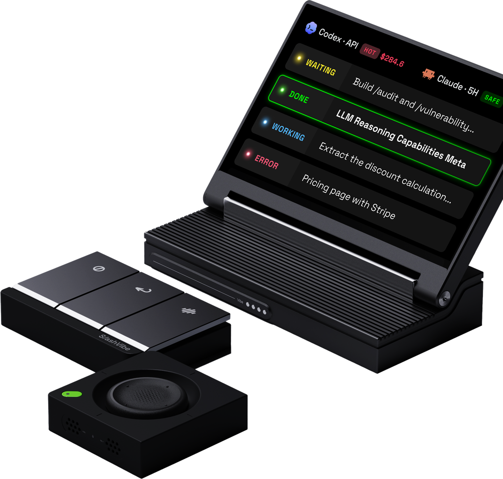

  

  

  
  
  

I build embedded systems where firmware, displays and on-device AI meet — MCU drivers and LVGL interfaces on one end, NPU model deployment and the host software that talks to the hardware on the other.

<b>中文简介</b>

 
SlashVibe 嵌入式负责人（Embedded Lead），就读于中山大学电子与信息工程学院（SEIT）。关注嵌入式固件、屏幕交互与端侧 AI：一端是 MCU 驱动和 LVGL 界面，另一端是 NPU 模型部署，以及与硬件通信的主机端软件。

## SlashVibe

<table>
<tr>
<td width="44%" align="center" valign="middle">

</td>
<td width="56%" valign="top">
<b>A physical controller for AI coding agents.</b>
  
Its display keeps every agent session in view, a joystick flicks between them, and action keys plus a built-in mic let you record, send or cancel a prompt without leaving the editor. It works alongside Claude Code, Codex, Cursor and other agent tools.
  
I lead the embedded team and own the device side of the product:
<ul>
<li>Device firmware</li>
<li>On-device display UI</li>
<li>Device–host protocol</li>
</ul>

</td>
</tr>
</table>

> [!NOTE]
> The product code is closed-source. Reusable components may be open-sourced later and will be listed here.
> 产品代码暂不开源，后续拆出的通用组件会在这里列出。

## Selected projects

<table>
<tr>
<td width="40%" valign="middle">

</td>
<td width="60%" valign="top">
<a href="https://github.com/skyswordx/ESP32-S3-ELECTRONIC-LOAD"><b>ELEVOURER · ESP32-S3 electronic load</b></a>
 skyswordx/ESP32-S3-ELECTRONIC-LOAD · core contributor
  
Portable smart electronic load with CC / CP / CR modes, real-time power monitoring and a touchscreen GUI, built for the SYSU SEIT engineering practice course.
  
<b>My part:</b> closed-loop current PID control, INA226 sensor calibration, DAC output and over-voltage protection, load-regulation testing, the LVGL waveform UI, LCD multi-buffering and the IPS panel driver.
  

</td>
</tr>
</table>

<table>
<tr>
<td width="50%" valign="top">
<a href="https://github.com/Triwalt/Viewterbi"><b>Viewterbi</b></a>
 Web · teaching tool
  
Interactive visualizer that steps through convolutional encoding and Viterbi / BCJR decoding on a live trellis, built for teaching channel coding.
  

</td>
<td width="50%" valign="top">
<a href="https://github.com/Triwalt/FlyKylin"><b>FlyKylin</b></a>
 Desktop + embedded Linux · on-device AI
  
LAN peer-to-peer messenger for Windows and RK3566, with NSFW image detection and semantic chat search running on-device through ONNX Runtime and the RKNN NPU.
  

</td>
</tr>
</table>

<b>More projects</b>

 
<table>
<tr>
<td width="30%"><a href="https://github.com/Triwalt/RAPID-FOC_MEA"><b>RAPID-FOC_MEA</b></a> C · STM32H7 · Python</td>
<td>Firmware and host tools for high-rate three-phase current sampling in FOC motor experiments</td>
</tr>
<tr>
<td><a href="https://github.com/skyswordx/Gesture-DetectionRecognition"><b>Gesture-DetectionRecognition</b></a> Python · contributor</td>
<td>Camera gesture recognition; I worked on fisheye correction, the recognizer and the on-screen visualizer</td>
</tr>
<tr>
<td><a href="https://github.com/Triwalt/codex-provider-sync-mac"><b>codex-provider-sync-mac</b></a> Swift · macOS</td>
<td>Small macOS utility that restores Codex history hidden after switching <code>model_provider</code></td>
</tr>
</table>

## Upstream contributions

| Project | Contribution | Status |
| --- | --- | --- |
|  [lvgl/lvgl](https://github.com/lvgl/lvgl) | [Skip fully transparent ARGB8888 additive blends onto RGB565](https://github.com/lvgl/lvgl/pull/10309) |  |
|  [espressif/esp-iot-solution](https://github.com/espressif/esp-iot-solution) | [Add init control flags to the ST7701 MIPI LCD driver](https://github.com/espressif/esp-iot-solution/pull/743) |  |
|  [espressif/esp-idf](https://github.com/espressif/esp-idf) | Reported two PPA scale-rotate-mirror bugs and tested fixes on hardware ([#18768](https://github.com/espressif/esp-idf/pull/18768), [#18780](https://github.com/espressif/esp-idf/pull/18780)) |  |

Also contributed exam recaps to SYSU SEIT course repositories: [SYSU_SEIT_Exam](https://github.com/baceoog/SYSU_SEIT_Exam) · [SEITNoteBook](https://github.com/gear0803/SEITNoteBook)

## Toolbox

<table>
<tr>
<td width="22%"><b>Languages</b></td>
<td></td>
</tr>
<tr>
<td><b>Embedded</b></td>
<td> <code>ESP-IDF</code> <code>STM32</code> <code>LVGL</code> <code>FreeRTOS</code> <code>RT-Thread</code> <code>BLE</code> <code>FOC</code></td>
</tr>
<tr>
<td><b>AI &amp; robotics</b></td>
<td> <code>RKNN</code> <code>ONNX Runtime</code> <code>RealSense</code></td>
</tr>
<tr>
<td><b>Apps &amp; tools</b></td>
<td></td>
</tr>
</table>

## Activity

  

  

<picture>
  <source media="(prefers-color-scheme: dark)" srcset="https://raw.githubusercontent.com/Triwalt/Triwalt/output/github-snake-dark.svg" />
  
</picture>

